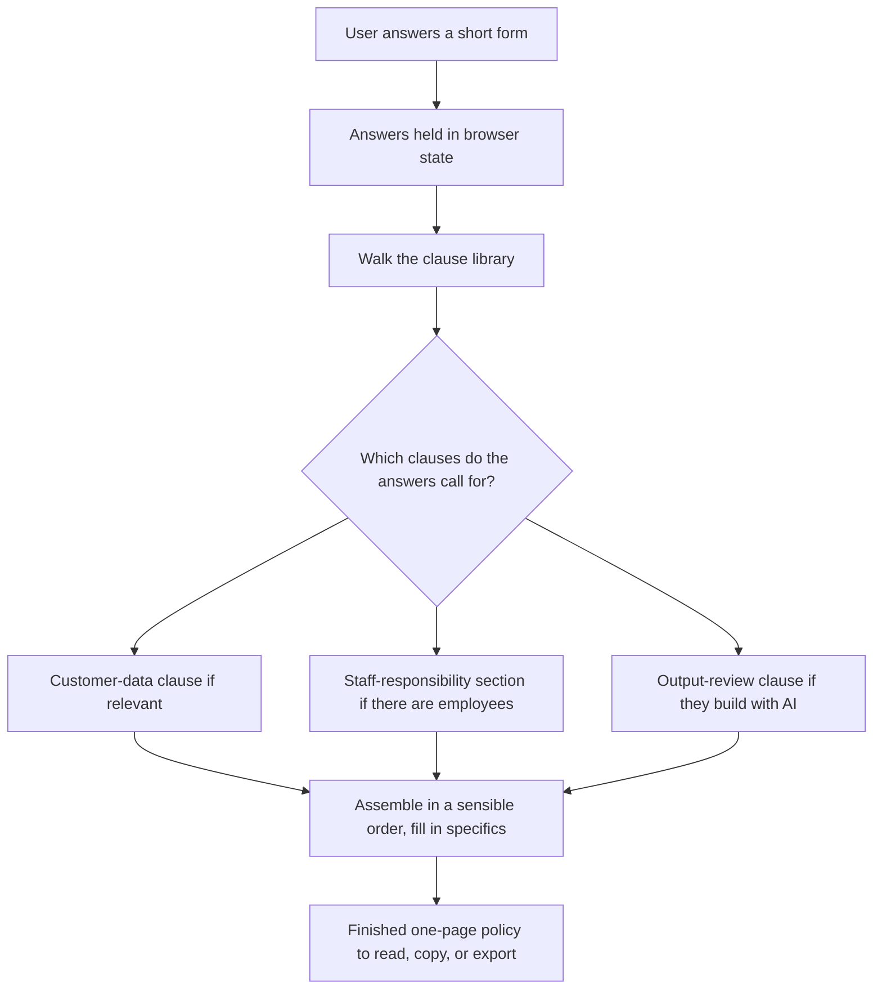

# AI Use Policy Builder

> Turns a short set of answers about how a business works into a finished, one-page AI use policy it can adopt, edit, or hand to an advisor.

**Status:** Live · **Type:** Browser-only web app · Part of the InfoSec Infirmary tool suite

> **This is a documentation repository.** It describes what the tool does and how it is designed. It does not contain the product source code or the clause library, which are private.

## The problem

Almost every business now has staff using AI tools, and almost none have a written rule for it. That is how a client list or a password ends up pasted into a chatbot. A blank "write your own AI policy" page helps no one, and a generic template ignores how the specific business actually operates. This tool is the middle path: fast, specific, and usable without a lawyer.

## What it does

The user answers a short form about how the business works: whether staff use AI, whether customer data is involved, whether they build products with AI, and so on. The tool assembles a tailored one-page policy from those answers and presents it to read, copy, edit, or export.

## How it works (high level)

This is a document generator, and the interesting part is the engineering choice behind it. The tool is built template-first rather than letting a language model free-write the policy. Pre-written clauses are stored as data, and the answers decide which clauses are included and in what order, filling in the business's specifics.

### Why template-first, not a language model

This is a real engineering trade-off, and the choice is deliberate:

- **Template-based (chosen):** Every output is predictable, accurate, and in a vetted voice. It is free to run, instant, and works with no server and no secrets. A policy has to be right every time, not creative.
- **Model-generated (not chosen):** More flexible, but it can drift or invent, costs money per use, needs a server with a key, and every output would need review before it reached a client.

For a one-page policy where accuracy and consistency matter most, the deterministic approach keeps the tool trustworthy. Fittingly, a free-writing model feature is exactly the kind of thing the [Injection Probe](../injection-probe) exists to test.

## Tech stack (high level)

- **Front end:** A component-based JavaScript UI with local state.
- **Back end:** None. The tool runs fully in the browser because it needs no secrets and no outside calls.
- **Generation:** Deterministic assembly from a library of pre-written clauses.

## Domain knowledge behind it

- **Shadow AI:** Staff quietly using AI tools the business never approved, the AI version of shadow IT.
- **Data leakage:** The core danger, pasting confidential material into third-party AI tools that may store or train on it.
- **Why a written policy matters:** It turns a vague worry into enforceable ground rules, and it is often the first thing an auditor, client, or insurer asks to see. It is a Govern-function control in NIST framework terms.

## What's in this repo

High-level overview, architecture diagram, and the design rationale. No source code and no clause library.

## Contact

Built and maintained by InfoSec Infirmary. Learn more at [infosecinfirmary.com](https://infosecinfirmary.com/).
