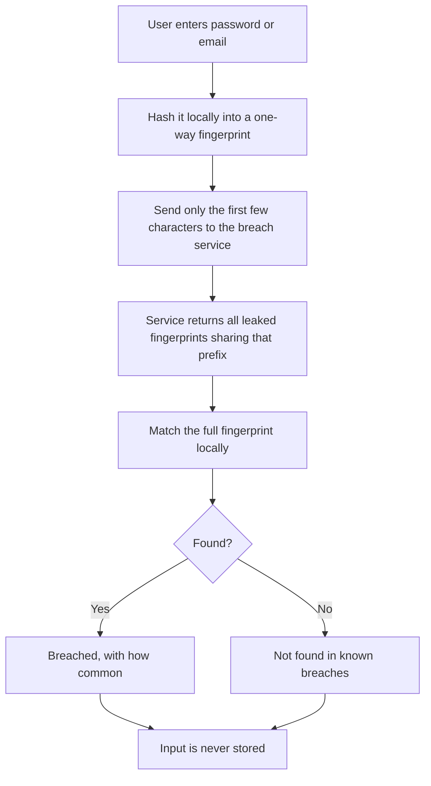

# Bloodwork — Breach and Exposure Check

> Tells a business whether its email or password has turned up in a known data breach, without ever handling the real secret.

**Status:** Live · **Type:** Web app with a privacy-preserving lookup · Part of the InfoSec Infirmary tool suite

> **This is a documentation repository.**

## The problem

Billions of email-and-password pairs have leaked in data breaches over the years. If yours is among them, attackers can try it on your other accounts. People need a way to check their exposure, but a tool that asked you to send your real password to a third party would be reckless. Bloodwork proves the answer while protecting the very thing you are asking about.

## What it does

The user enters an email or password to check. The tool reports whether it appears in known breaches, and for passwords, how common the exposure is. The real password or email never leaves the user's side, and the breach service never learns what was searched. This is the basis of the brand promise: it checks the sample and never keeps it.

## How it works (high level)

The clever part is a privacy-preserving lookup built on two ideas: hashing and k-anonymity.

The input is converted into a one-way fingerprint called a hash. Only the first few characters of that fingerprint are sent to the breach service. The service returns every leaked fingerprint that shares those few characters, which is a crowd of hundreds, and the final match happens locally on the user's side. Because the service only ever saw a prefix shared by many different secrets, it cannot tell which one was being checked.

The privacy here is not a promise, it is built into the math of the request.

## Tech stack (high level)

- **Front end:** A component-based JavaScript UI.
- **Lookup:** A range query against a public breach database using the k-anonymity model popularized by Have I Been Pwned.
- **Data handling:** The input is hashed locally and discarded. Nothing sensitive is stored.

## Security concepts behind it

- **Hashing:** A one-way function that turns any input into a fixed fingerprint you cannot reverse.
- **k-anonymity range query:** Sending only a short prefix so the real secret hides in a crowd of possibilities.
- **Data breaches and credential stuffing:** Why a leak of one site threatens your other accounts, and why the fix is a unique password everywhere plus multi-factor authentication.

## Contact

Built and maintained by InfoSec Infirmary. Learn more at [infosecinfirmary.com](https://infosecinfirmary.com/).
