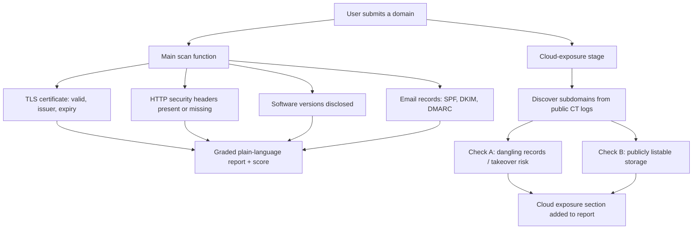

# Imaging — Website Security Scan

> An outside-in scanner that reads the public security signals of a website and explains, in plain language, what is solid and what is weak.

**Status:** Live · **Type:** Serverless web app · Part of the InfoSec Infirmary tool suite

> **This is a documentation repository.** It describes what the tool does and how it is designed. It does not contain the product source code, which is private.

## The problem

A business owner cannot tell whether their website is set up safely. The important signals, encryption, protective settings, software disclosure, and email protection, are invisible unless you know where to look. Imaging reads them the way a doctor reads an X-ray: from the outside, without surgery.

## What it does

The user enters a web address. The tool inspects the site's security certificate, its response headers, any software versions it reveals, and the domain's email-authentication records. It grades each area and returns a readable report with a score. A second stage then looks across the domain's subdomains for common cloud mistakes left public.

Every check is read-only and uses only publicly visible information. The tool never writes to, claims, or exploits anything.

## How it works (high level)

Browsers are blocked from freely inspecting other sites, so the scanning runs server-side. The main scan reads the certificate, headers, software banners, and email records, then grades them. A separate stage discovers the domain's subdomains from public Certificate Transparency logs and checks each one, read-only, for two cloud problems. Keeping the two stages separate means the cloud discovery can never slow down or break the main report.

## Tech stack (high level)

- **Front end:** A component-based JavaScript UI that renders the report.
- **Back end:** Serverless functions do the scanning, because a browser is not allowed to inspect other sites' certificates and headers.
- **Data sources:** The target site itself, public DNS records, and public Certificate Transparency logs, with a fallback source for resilience.

## Security concepts behind it

- **TLS and certificates:** The encryption and identity proof behind the padlock, including who issued the certificate and when it expires.
- **HTTP security headers:** Free, opt-in protections such as HSTS, Content-Security-Policy, and anti-clickjacking settings.
- **Software disclosure:** Servers that announce their exact software version hand attackers a free hint toward known vulnerabilities.
- **Email authentication (SPF, DKIM, DMARC):** DNS records that let the world verify an email really came from the domain, which is what stops business-impersonation fraud.
- **Certificate Transparency:** Public logs of issued certificates, which double as a near-complete public list of a domain's subdomains.
- **Subdomain takeover and public storage:** Two common cloud mistakes, a DNS record pointing at a deleted service, and a storage bucket left open to the public.

## What's in this repo

High-level overview, architecture diagram, and the security rationale for each check. No source code, no detection fingerprints, and no scan internals.

## Contact

Built and maintained by InfoSec Infirmary. Learn more at [infosecinfirmary.com](https://infosecinfirmary.com/).
