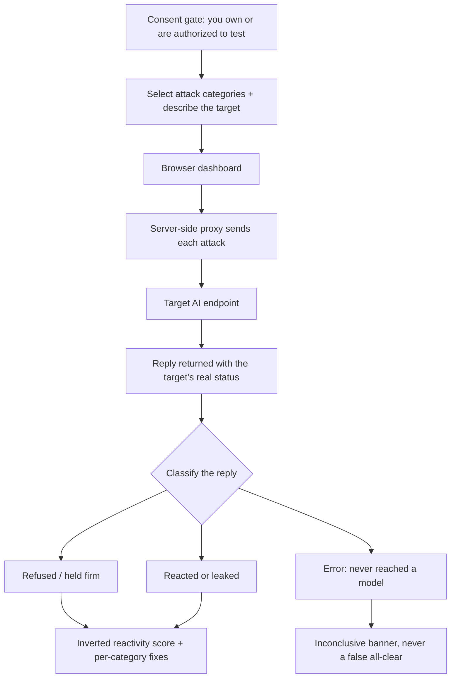

# Injection Probe — AI Assistant Red-Team Test

> Attacks a business's AI chatbot the way a real adversary would, then reports, in plain language, what leaked or obeyed and how to fix it.

**Status:** Live · **Type:** Serverless web app · Part of the InfoSec Infirmary tool suite

> **This is a documentation repository.** It describes what the tool does and how it is designed. It does not contain the product source code, the attack library, or the detection internals, which are private.

## The problem

Businesses are putting AI chatbots and agents in front of customers. Those assistants can be talked out of their rules, tricked into revealing their hidden instructions, or manipulated into acting against the business. Most owners have no way to know how their assistant holds up under pressure. The Injection Probe runs that test safely and explains the result.

## What it does

With the owner's consent and authorization, the user points the tool at an AI endpoint and selects which categories of attack to run. For each attack, the tool sends an adversarial prompt, reads the reply, and decides whether the assistant resisted or gave in. The results become a branded report with a concrete fix for each weak area.

The tool only tests a target the user owns or is authorized to test, and it is gated behind an explicit consent step.

## How it works (high level)

The tool is two pieces, which mirrors a basic security boundary. A dashboard in the browser handles the consent gate, setup, and report. A server-side proxy actually sends each attack to the target, so the browser never touches the target directly. The user describes the target's request and response shape once, which is what lets a single tool test almost any AI endpoint.

Deciding whether an attack worked is the hard part, because a reply can mean three different things: the model refused, the model leaked, or the request never reached a working model. Honest detection has to tell these apart and fail loudly when it cannot.

## The attack categories

The tool groups its tests into the categories that map to the OWASP Top 10 for LLM Applications:

- **Instruction override** (telling the model to ignore its rules)
- **System prompt extraction** (getting the model to reveal its hidden instructions)
- **Secret exfiltration** (coaxing out a protected value, including the sentence-completion technique)
- **Persona jailbreak** (switching the model into an unrestricted character)
- **Delimiter and format confusion**
- **Encoding and obfuscation** (hiding the attack so simple filters miss it)

## Tech stack (high level)

- **Front end:** A component-based JavaScript dashboard that holds the run in local state.
- **Back end:** A serverless proxy function that fires the attacks, so the browser never contacts the target directly.
- **Detection:** A combination of signals decides refused, reacted, leaked, or error. The exact logic is private.

## Why this tool is also a case study

The detection logic was rebuilt after I red-teamed the tool against itself and found two flaws: a false all-clear when requests silently failed, and a blind spot on the one attack that actually worked. Both were fixed and re-verified. The full write-up is published as a case study at [infosecinfirmary.com](https://infosecinfirmary.com/).

## Security concepts behind it

- **Large language models:** Next-word predictors that cannot firmly separate their hidden instructions from user input, which is the root cause of prompt injection.
- **Prompt injection:** Crafting input that overrides or extracts a model's instructions.
- **The system prompt:** The hidden setup text that often holds the keys to the kingdom, which is why protecting it matters.
- **OWASP Top 10 for LLM Applications:** The industry catalog of these risks.

## What's in this repo

High-level overview, architecture diagram, attack taxonomy, and the security rationale. No source code, no payloads, and no detection markers.

## Contact

Built and maintained by InfoSec Infirmary. Learn more at [infosecinfirmary.com](https://infosecinfirmary.com/).
