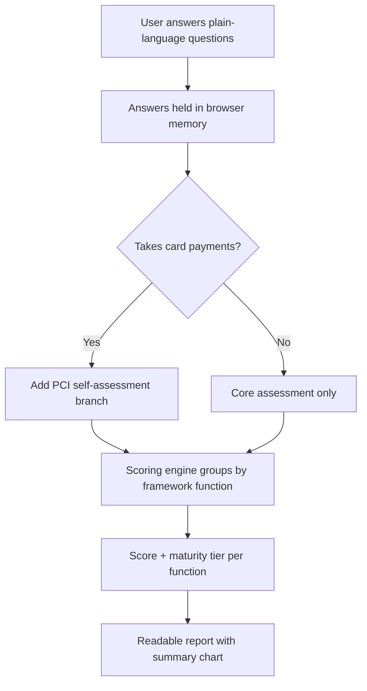

# Intake — Security Posture Check

> A guided self-assessment that scores a small business against the NIST Cybersecurity Framework 2.0 and shows where it stands.

**Status:** Live · **Type:** Browser-only web app · Part of the InfoSec Infirmary tool suite

> **This is a documentation repository.**

## The problem

Most small business owners have no idea how their security actually measures up. Professional frameworks exist, but they are dense and written for auditors, not owners. The Intake turns that complexity into a set of plain questions and returns a clear, scored picture of where the business stands.

## What it does

The user answers a short set of questions. The tool scores the answers across the six functions of the NIST Cybersecurity Framework and reports a maturity tier for each, along with a visual summary. If the business takes card payments, an extra branch points them toward the right PCI self-assessment path.

Everything runs on the user's own device. No answers are sent anywhere, because the assessment needs no secrets and no server work.

## How it works (high level)

The questions are stored as structured data, each tagged with the framework control it maps to. As the user answers, their choices are held in memory in the browser. A scoring function groups the answers by framework function, converts each group into a score, and labels it with a maturity tier. A conditional branch adds the payment-card path only when it is relevant.

## Tech stack

- **Front end:** A component-based JavaScript UI with local state.
- **Charting:** A charting library renders the per-function summary.
- **Back end:** None. The tool is fully client-side, which makes it instant, private, and free to run.

## Security concepts behind it

- **NIST Cybersecurity Framework 2.0:** Organizes security into six functions, Govern, Identify, Protect, Detect, Respond, and Recover, each broken into categories and controls.
- **Maturity tiers:** Describe how mature a practice is, on a ladder from ad hoc to continuously improving, rather than a simple pass or fail.
- **PCI DSS Self-Assessment Questionnaires:** The compliance path for businesses that handle credit card data, with different questionnaire types depending on how payments are taken.

## Contact

Built and maintained by InfoSec Infirmary. Learn more at [infosecinfirmary.com](https://infosecinfirmary.com/).
