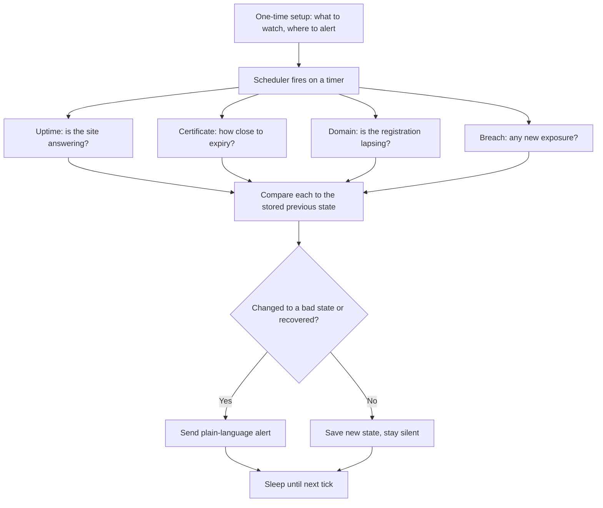

# Vitals — Uptime and Certificate Monitor

> Watches a business's website, certificate, domain, and email exposure around the clock, and speaks up only when something is wrong.

**Status:** Live · **Type:** Scheduled monitoring service · Part of the InfoSec Infirmary tool suite

> **This is a documentation repository.** It describes what the tool does and how it is designed. It does not contain the product source code, which is private.

## The problem

The most damaging failures are the quiet ones. A certificate expires at 2 a.m. A domain registration lapses. A site goes down. A new breach exposes a business email. Nobody notices until a customer does. Vitals catches these early, usually before anyone would have seen them.

## What it does

The user sets up what to watch once. After that, the service runs on a repeating schedule, checks a handful of signals, compares each to the last known state, and sends a plain-language alert only when something changes from fine to not-fine. The rest of the time it stays silent.

## How it works (high level)

Unlike the on-demand tools, Vitals is built around a repeating schedule. A timer wakes small checks on a clock, every few minutes for uptime and daily for the slower-moving signals. Each check is compared against a stored previous state, so an alert fires on a real change, not on every run. This change detection is what keeps the alerts rare enough to be trusted.

## Tech stack (high level)

- **Scheduling:** A cron-style timer drives the checks.
- **Checks:** Serverless functions test uptime, certificate expiry, domain expiry, and breach exposure.
- **State:** A small persistent store remembers the previous result, which is what makes change detection possible.
- **Alerting:** Notifications are delivered through a messaging channel in plain language.

## Security and reliability concepts behind it

- **Scheduled work (cron):** Running a small job on a repeating clock instead of waiting for a user.
- **Change detection:** Alerting on a transition, not on every check, so the signal stays trustworthy.
- **Silent failures:** There is no attacker here, just entropy. Things expire, lapse, and drift, and the business impact is real even though nothing was hacked.
- **The Detect function:** Monitoring is the discipline behind the Detect function of the NIST framework. You cannot respond to what you never notice.

## What's in this repo

High-level overview, architecture diagram, and the monitoring rationale. No source code and no alerting internals.

## Contact

Built and maintained by InfoSec Infirmary. Learn more at [infosecinfirmary.com](https://infosecinfirmary.com/).
